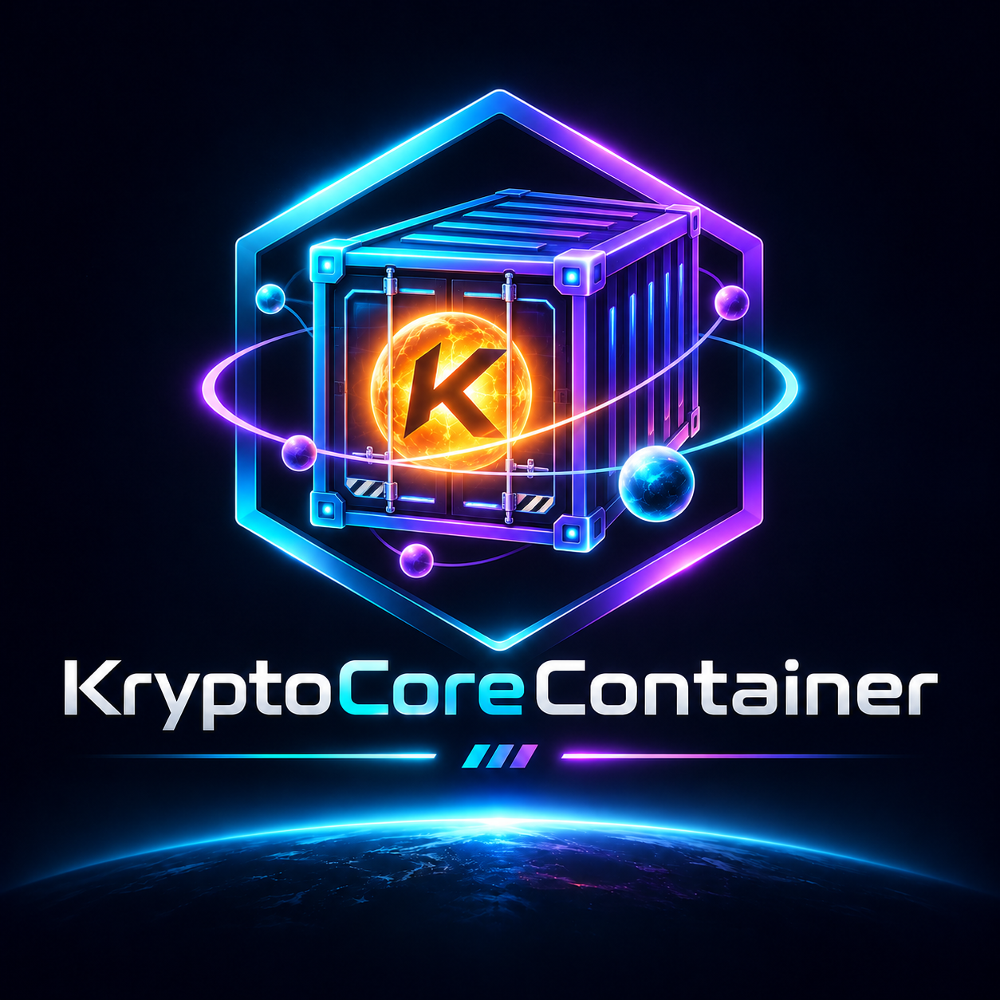

# KryptoCore Container

[Standalone Windows builds and requirements](PORTABLE.md)

[Unreleased design preview](DESIGN.md)

Portable encrypted archives for files and folders. Powered by the open-source
[KryptoCore library](https://github.com/kryptocorelabs/kryptocore).

[Downloads](https://github.com/kryptocorelabs/container/releases)
· [Usage](USAGE.md) · [Security](SECURITY.md)

Testing to date has been carried out by the KryptoCoreLabs maintainers, locally
and through automated CI. No independent security audit has been completed.
We welcome community testing, code reviews and scrutiny of our security
assumptions. Please use synthetic data and report suspected vulnerabilities
privately through the project's security-reporting channel.

## Source and community

[Browse the implementation](https://github.com/kryptocorelabs/apps-source/tree/main/apps/container) or
read the [project charter](https://github.com/kryptocorelabs/kryptocore/blob/main/PROJECT_CHARTER.md). First-party code is MIT licensed;
dependencies retain their own terms. Contributions and independent review are
welcome. Source visibility does not change the documented preview limits.

## Get started

Download and extract the Windows x64 ZIP and open KryptoCore-Container.exe.
No separate Python or .NET installation is required.

1. Select **Dateien verschlüsseln**, add copies of files and choose a passphrase.
2. Save the encrypted archive and share the passphrase separately.
3. The recipient opens the archive in Container and extracts it to a new folder.

The Windows runtime is included. Optional OpenSSH and ClamAV tools are installed separately.

## Preview status

Version 0.1.0-alpha.2-preview.1. Use synthetic data and retain original files and
independent backups. The executable is unsigned. There is no independent
security audit or guarantee of recovery after losing a passphrase or identity.

This repository hosts documentation and downloads. Application source is
[open under MIT](https://github.com/kryptocorelabs/apps-source/tree/main/apps/container). Third-party
components retain their own terms. The ZIP includes license texts and notices.

For an independent offline interface to existing KCC files, see the
[Rescue preview](https://github.com/kryptocorelabs/rescue). It uses the same
authenticated reader and writes to a fresh destination. It does not replace
Container's sender-signature or optional scanner tools.

## Shared signatures and scan limits

The current preview adds **Signaturen** for protected `.kcsk` keys,
public `KCP1:` codes and detached `.kcsig` files. Verify/extract with
Container or Rescue using an independently confirmed public code.
See [signature protocol](SIGNATURES.md), [malware checks](MALWARE-PROTECTION.md)
and [release notes](RELEASE_NOTES.md). ClamAV is an external optional tool;
a failed requested scan blocks output. Existing OpenSSH options remain available.
